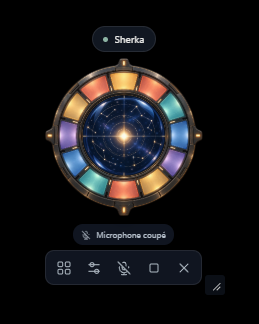

# Sherka Companion

**A voice. A personality. A memory. A companion that lives on your desktop.**

Sherka turns AI models into someone you can talk to. A transparent desktop companion, a voice for each character, and memories that grow with your conversations. Keep intelligence local, or connect your preferred API.

**Your companion has its own transparent desktop widget.** Move it wherever you like and keep talking with the control panel closed. Hover or click to reveal its controls; move away to return to the avatar alone.

[Download for Windows](https://github.com/ArthurReboulSalze/Sherka-Compagnon/releases/latest) · [Get started](docs/GETTING_STARTED.md) · [Documentation](docs/README.md) · [Roadmap](docs/ROADMAP.md)

## Talk, interrupt, pick up again

- **Continuous voice conversations.** Text streams as it is generated. Upcoming speech is prepared while the current passage plays, reducing pauses. Speak again to interrupt a response.
- **A quiet presence.** Your companion appears at startup. Controls show on hover or click; open the control panel whenever you need it.
- **Independent characters.** Each has its own personality, image, voice, provider, model and memories. Switching companions also manages local model loading and unloading.
- **Memory you control.** Essential memories and topical drawers, editable in the interface or through conversation.
- **Context awareness.** Sherka budgets against the available context and reserves room for the reply. Reasoning controls appear when supported.
- **Simple updates.** Check GitHub from Settings and install a signed update, keeping your profiles and memories.
- **Your language.** Seven interface languages and a ready-to-use Sherka in each one. Custom companions keep their own language. [Language settings](docs/LANGUAGES.md).
- **Look things up.** Optional [DuckDuckGo search](docs/WEB_SEARCH.md), with source links and no account or API key. Off by default; search queries go online.

## Local voice, your choice of intelligence

**[VoiceStudio](https://github.com/debpalash/VoiceStudio) is required** for speech recognition, synthesis and voices. Sherka starts its installed Windows application when needed.

**[LM Studio](https://lmstudio.ai/) is the default for local intelligence.** You can also choose **OpenRouter, Z.ai (API or Coding Plan), OpenAI, Anthropic**, or a compatible API for each character. API keys are protected by Windows and excluded from exported profiles. [Provider setup](docs/PROVIDERS.md).

Install VoiceStudio and its models separately. With LM Studio and downloaded models, conversation can work offline. Remote providers receive the prompt, selected exchanges and recalled memories, and may charge for usage; voice processing stays local. Speed depends on your hardware and model choices. Headphones are recommended for voice interruption; the microphone is off at startup.

## Install it, or just run it

Choose the **Windows x64 installer** or the **no-install ZIP** from [Releases](https://github.com/ArthurReboulSalze/Sherka-Compagnon/releases/latest). Both require WebView2 and the Visual C++ x64 runtime, and store data in your Windows user folder. Choose French, English, Spanish, Italian, German, Simplified Chinese or Japanese in Settings.

Sherka is a working early project. Next come richer avatar customization, speaking and listening animations, expressions and moods. See the [roadmap and current limitations](docs/ROADMAP.md).

## Open source

Sherka's code is licensed under **[GPLv3](LICENSE)**. Dependencies retain their [own licenses](THIRD_PARTY_NOTICES.md). The retrofuturistic artwork is an original, freely inspired creation; no Ulysses 31 artwork is distributed and the project is unaffiliated with the series.

Want to contribute? [Build and test](docs/DEVELOPMENT.md), then open an [issue](https://github.com/ArthurReboulSalze/Sherka-Compagnon/issues) or a pull request.
