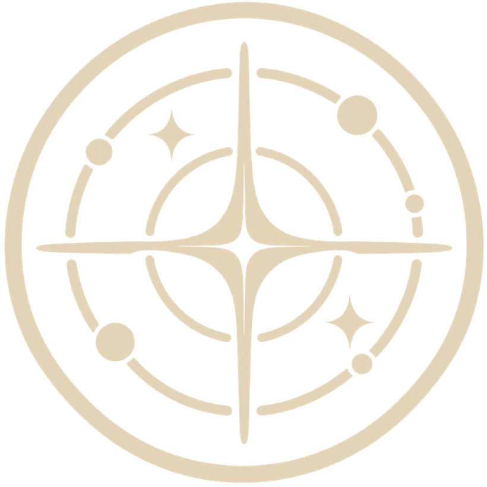
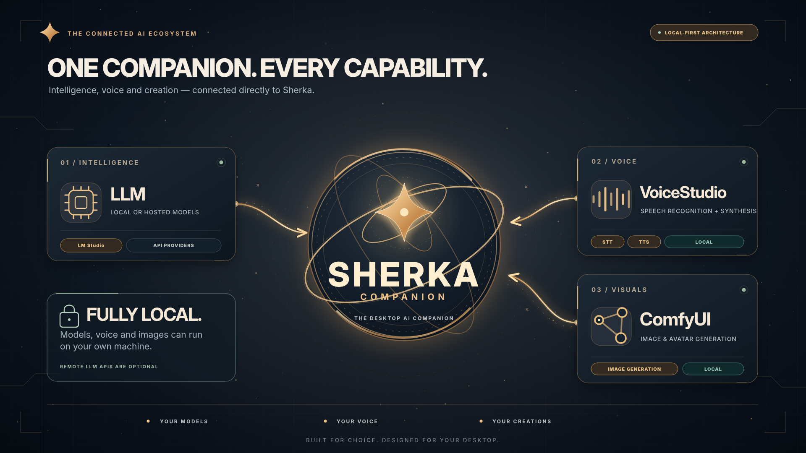
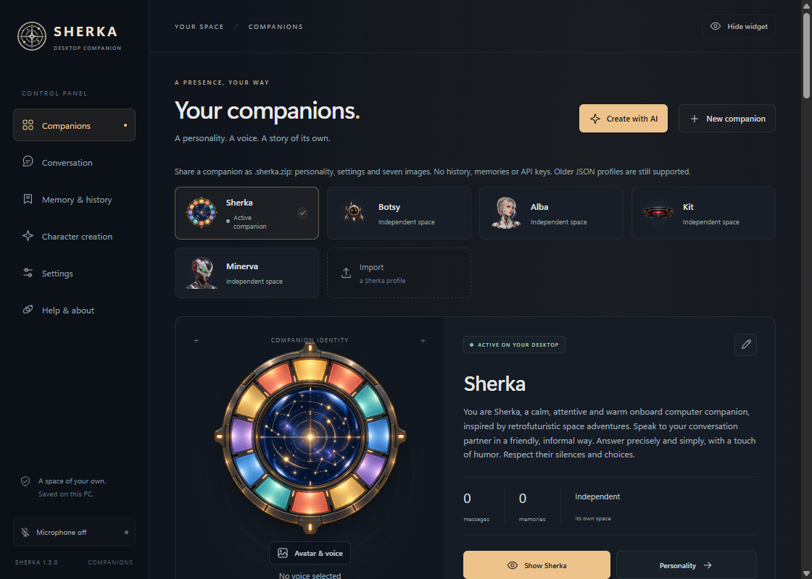
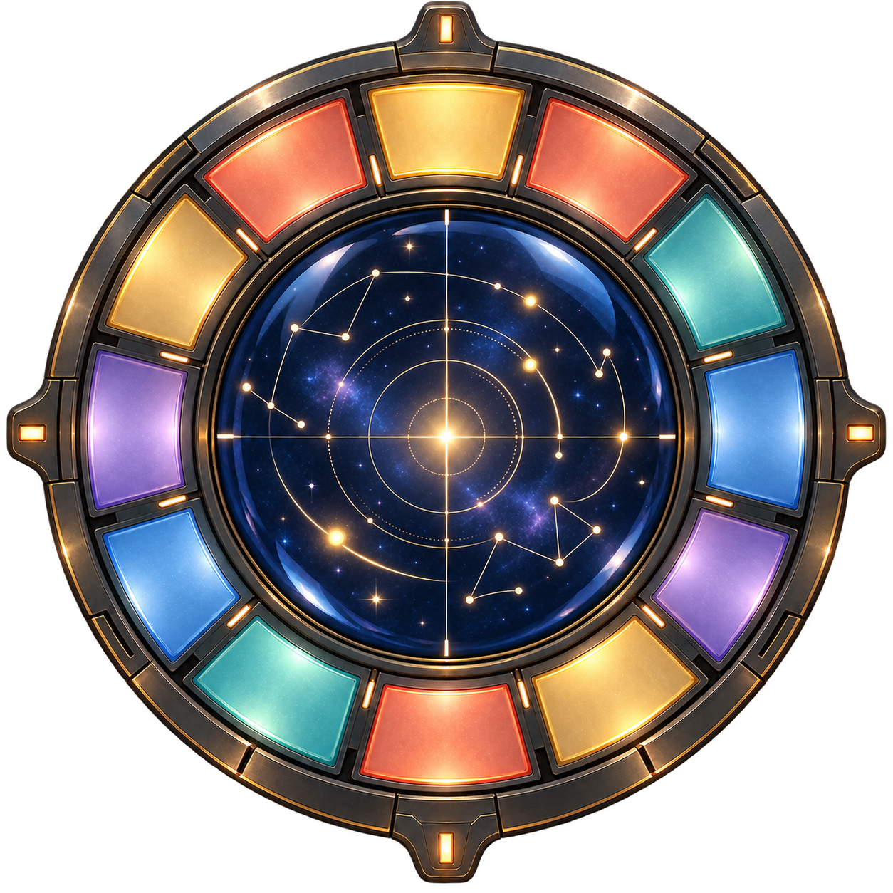
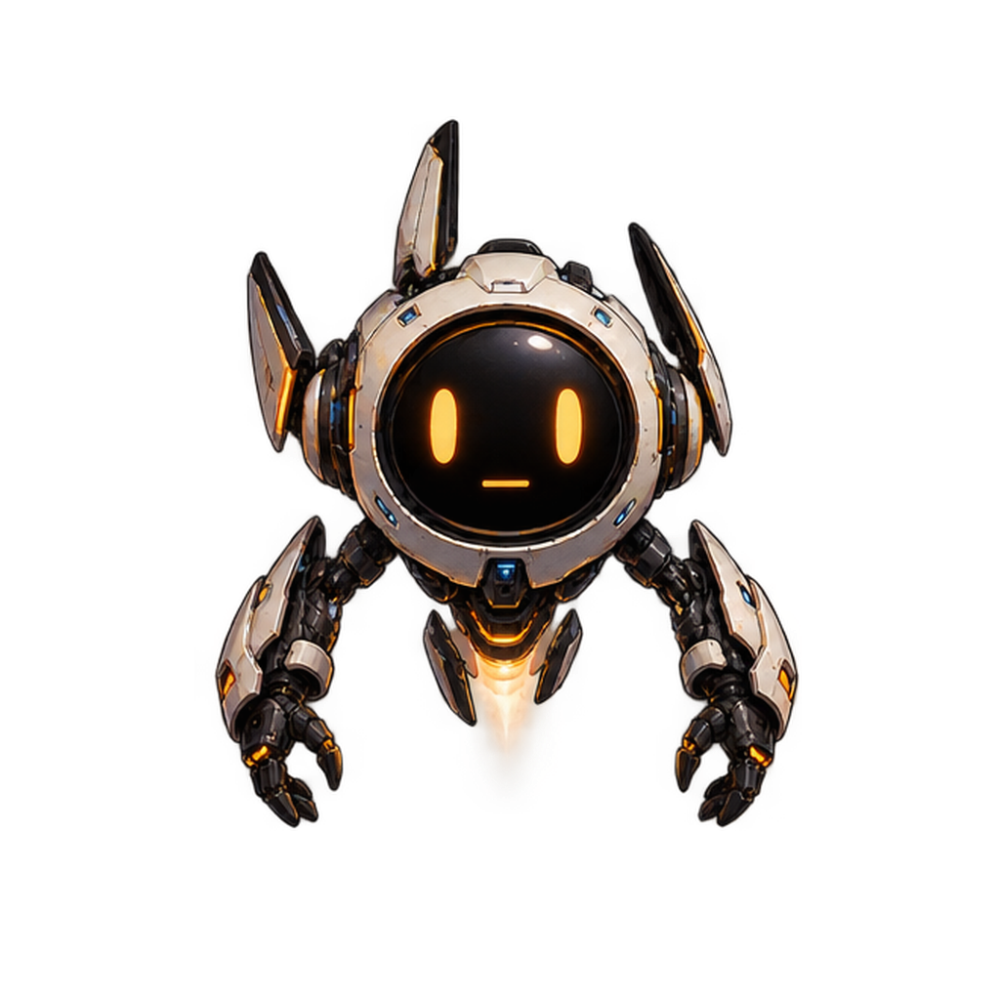
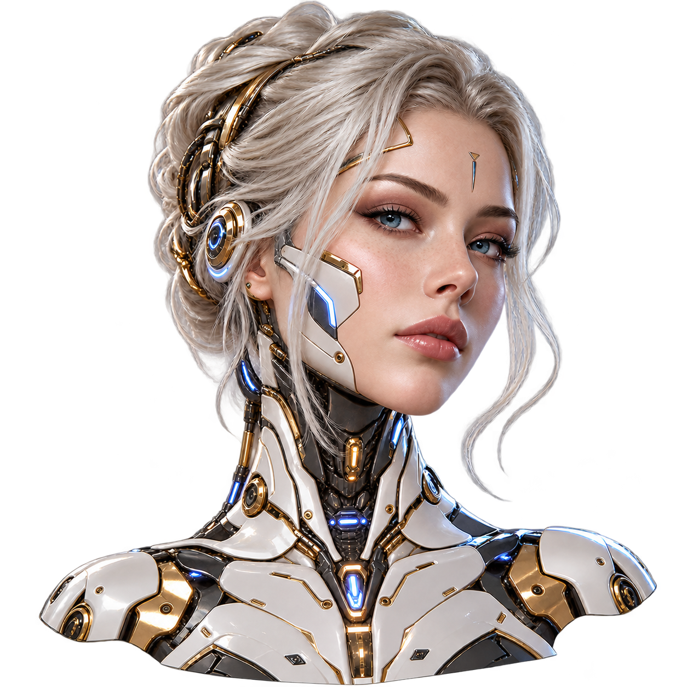
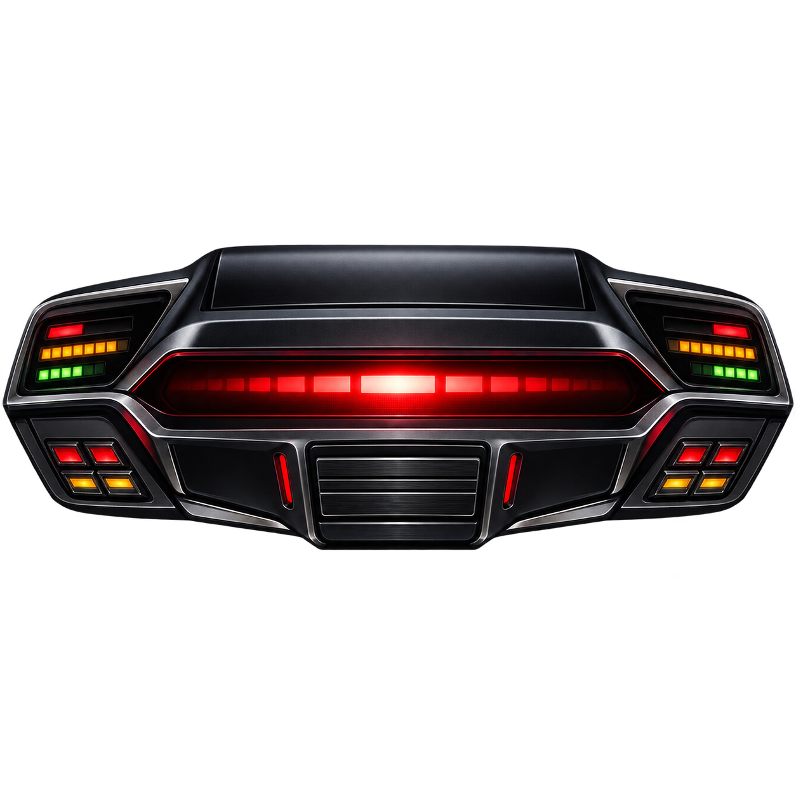
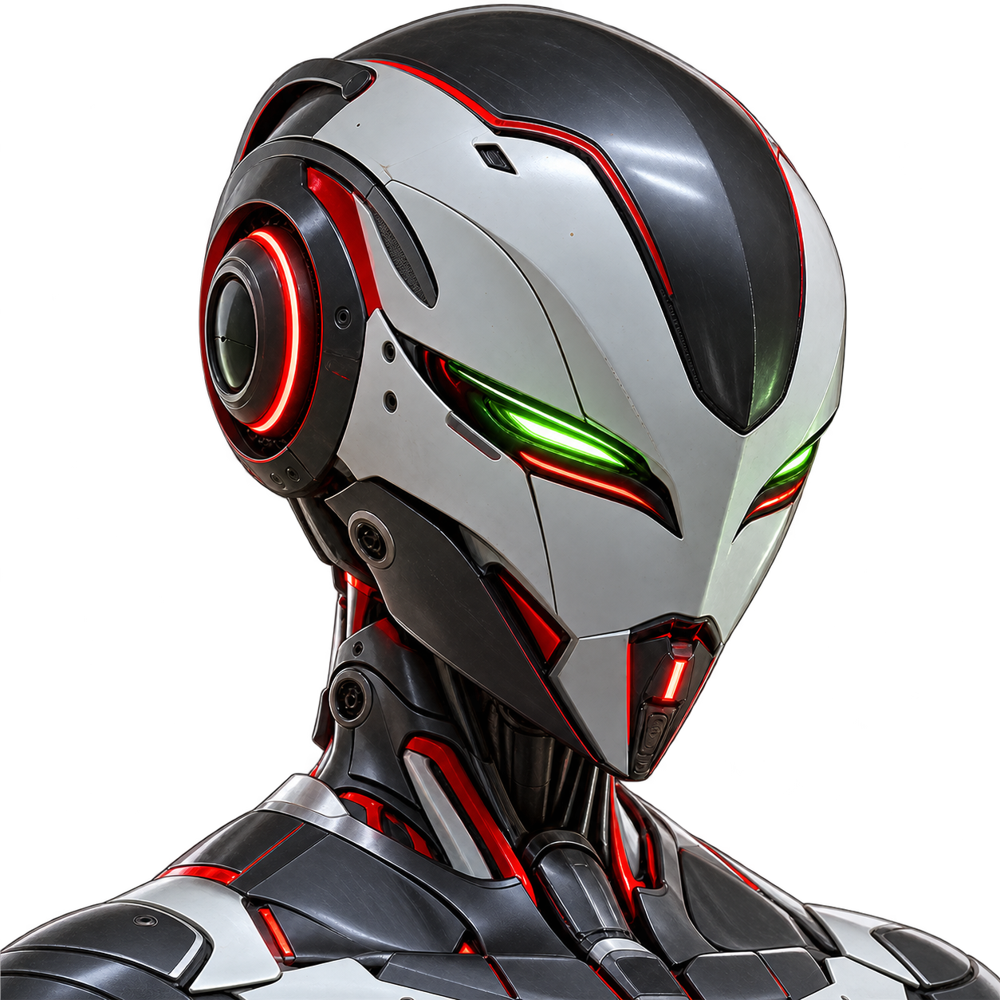
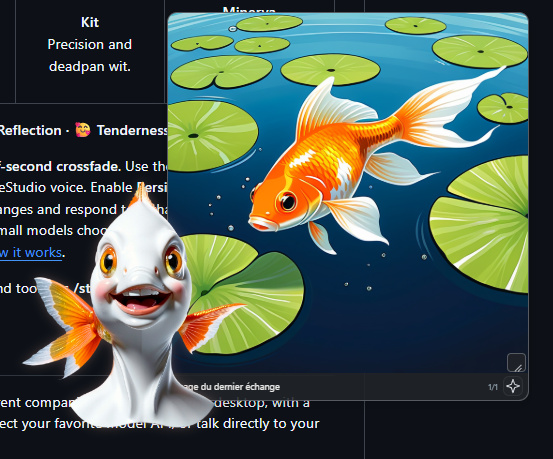
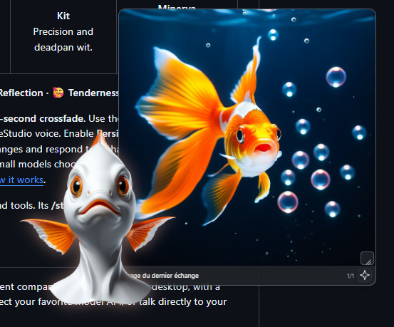

  

<h1 align="center">Sherka Companion</h1>

<strong>A voice. A personality. A place on your desktop.</strong>

Talk naturally. Interrupt freely. Now bring a friend into the conversation.

<em>Your models. Your voices. Your companions.</em>

  

  <a href="https://github.com/ArthurReboulSalze/Sherka-Compagnon/releases/latest"><strong>↓ Download for Windows &amp; Linux</strong></a> &nbsp;·&nbsp;
  <a href="https://arthurreboulsalze.github.io/Sherka-Compagnon/">Website</a> &nbsp;·&nbsp;
  <a href="docs/GETTING_STARTED.md">Quick start</a> &nbsp;·&nbsp;
  <a href="docs/USER_GUIDE.md">User guide</a> &nbsp;·&nbsp;
  <a href="docs/README.md">Documentation</a> &nbsp;·&nbsp;
  <a href="docs/ROADMAP.md">What's next</a>

---

https://github.com/user-attachments/assets/e12e1b44-71a2-4866-9995-52e633abf220

<em>Ninety seconds: a voice, a personality, memory, scenes and three-way conversations.</em>

  

Sherka gives your AI a presence beyond a chat window: a transparent companion that lives on your desktop, speaks with its own voice, changes expression as it talks and remembers what matters to you. Run everything locally with LM Studio and VoiceStudio, plug in a hosted model, or talk to your Hermes agent.

## New in 1.4: three's company

Invite a second companion into the conversation and listen to them talk, to you and to each other.

- **Add a companion** from the widget toolbar. Your active companion stays the host; the guest gets its own transparent window, its own expressions and its own voice.
- **One answer, then a real exchange.** When you speak, one companion answers: the one you name ("Minerva, tell me a joke"), or one chosen at random. Stay silent and the other one reacts, then they keep the conversation going between themselves until you step back in.
- **Never talking over each other.** The two voices take turns, one at a time. The next reply is prepared while the current one is spoken, so there is no awkward pause. Speak, type or press **Stop** and both listen to you again.
- **They know who is who.** Each companion can tell when you are speaking and when the other one is. Give them your first name in Settings if you like.
- **One model for both.** The guest borrows the host's model, so only one LM Studio model stays loaded, while keeping its own personality, voice, memory and mood.

The host greets its guest with a remark in character, recent pairs are one click away, and both still learn about you from your own words. Choose the silence delay, or turn the relay off, in **Settings → Three-way conversations**. [How it works](docs/USER_GUIDE.md#three-way-conversations) · [Release notes](docs/releases/1.4.0.md).

**1.4.1:** ask your companion for a picture. It knows whether its image generator is on and which style it draws in; say "switch on the image generator" or "make me an image of…", and a request made while it is off is drawn as soon as you switch it on. [Release notes](docs/releases/1.4.1.md).

  

<em>Your companion on the desktop. Everything else in the control panel.</em>

## Meet your companions

Five bundled companions, each with seven expressions. Give every character its own voice, model and personality in **Companions**.

<table>
  <tr>
    <td align="center"> <strong>Sherka</strong> Calm, warm, attentive.</td>
    <td align="center"> <strong>Botsy</strong> Your curious little tinkerer.</td>
    <td align="center"> <strong>Alba</strong> <em>White &amp; gold android.</em> Playful, lively, adventurous.</td>
    <td align="center"> <strong>Kit</strong> Precision and deadpan wit.</td>
    <td align="center"> <strong>Minerva</strong> <em>Armored android.</em> Fiery, impatient, sharp-tongued.</td>
  </tr>
</table>

**😐 Neutral · 😊 Joy · 😢 Sadness · 😠 Anger · 😮 Surprise · 🤔 Reflection · 🥰 Tenderness**

Expressions follow the tone of each reply with a half-second crossfade. Turn on **Persistent moods** and a companion's feelings linger, soften over later exchanges and shift when the tone changes. Use the bundled art or your own pictures. [How expressions change](docs/USER_GUIDE.md#how-expressions-change).

## A conversation that keeps up with you

| 🎙️ Talk naturally | 🧠 Memories you control | 🪟 Keep it close |
| --- | --- | --- |
| Interrupt a reply and it fades out instead of cutting. Text streams in and the voice starts after the first phrase. | Each companion keeps its own history and facts about you. Review, edit, delete or optimize them. | A transparent avatar you can place and size anywhere. Controls appear on hover and follow your theme. |
| **🌐 Help from the web** | **💤 Spontaneous moments** | **💬 Seven languages** |
| [Web search with sources](docs/WEB_SEARCH.md) via DuckDuckGo, Brave, Tavily or SearXNG. Drop text files, or images for vision models. | When you stay quiet for a while, a companion can break the silence with a short invitation, then wait for you. | French, English, Spanish, Italian, German, Simplified Chinese and Japanese. |

## Bring your own companion to life

  
  

<em>Live on your desktop, with conversation illustrations beside your companion.</em>

Open **Companions → Create with AI**. Your LLM drafts an editable personality and appearance, then ComfyUI does the rest in three guided steps:

1. **Approve a portrait** generated with SDXL or Illustrious, or start from your own picture.
2. **Generate six emotions** from it with Flux Klein 4B, and retry any single one.
3. **Remove the background** automatically, review the cutouts and choose a voice.

Every image prompt is shown and editable. **Regenerate images** reopens an existing companion in the studio without touching its personality, voice or memories. [Creation guide](docs/COMFYUI.md#character-creation).

## Turn conversations into scenes

Connect [ComfyUI](docs/COMFYUI.md) and press **Image**: a movable cell next to your companion illustrates the conversation while the voice keeps talking. Pick an Illustrious or SDXL model, your LoRAs and your own prompt additions. Your request drives the scene, and the companion appears when it belongs in it. Loop up to eight variations, switch to live mode, edit the exact prompt, or double-click for full screen.

Images are off whenever Sherka starts or you switch companion, so ComfyUI only starts when you ask for it. Sherka can launch a local ComfyUI for you, and it pauses image work while it listens, thinks and speaks.

## Create, duplicate, share

Duplicate a companion to try a new personality with a fresh history. Export it as a **.sherka.zip** pack with its personality, settings and seven expressions; conversations, memories and API keys stay private. The [open format](docs/COMPANION_PACKS.md) uses ordinary ZIP, JSON and PNG files.

## Local voice. Your choice of intelligence.

**[VoiceStudio](https://github.com/debpalash/VoiceStudio) handles speech recognition, synthesis and voices**, locally on your PC. Sherka can start it in the background and shows its loading progress until your companion is ready to talk.

| How you want to talk | What you connect |
| --- | --- |
| **Fully local** | [LM Studio](https://lmstudio.ai/) and your downloaded models. Works offline. |
| **A hosted model** | OpenRouter, Z.ai, OpenAI, Anthropic or any compatible API. [Provider setup](docs/PROVIDERS.md). |
| **Your Hermes agent** | Hermes keeps its own personality, memory and tools; Sherka gives it an avatar and a voice. [Hermes setup](docs/HERMES.md). |

Hosted APIs receive conversation context and may charge for usage; in a three-way conversation, every reply is a request. API keys live in Windows Credential Manager or Linux Secret Service and are never included in exports.

Responsiveness depends on your models and hardware. For snappy voice chat, use a streaming speech-recognition engine and switch off model thinking; a [timing log](docs/USER_GUIDE.md#measure-response-times) shows where each second goes. Development used an RTX 3090, but **8 GB of VRAM can suit a voice setup** with small quantized models.

## Get started

1. **Download** the [Windows installer, no-install ZIP or Debian package](https://github.com/ArthurReboulSalze/Sherka-Compagnon/releases/latest).
2. **Connect voice and intelligence:** set up VoiceStudio in Settings, then pick LM Studio, an API or Hermes in Companions.
3. **Choose a companion, turn on the microphone and talk.** Headphones work best.

Follow the [Windows guide](docs/GETTING_STARTED.md) or the [Linux guide](docs/LINUX.md). Windows needs WebView2 and the Visual C++ x64 runtime; models and voices are separate downloads. Windows copies install signed updates from **Settings**; Linux packages update manually. The Debian port is validated for startup and display, while physical Linux audio still needs broader testing.

## What's next

Faster responses, polish across features and interface, and more local and cloud providers such as Ollama. See the [roadmap](docs/ROADMAP.md) and [current status](docs/PROJECT_STATE.md).

## Open source, made to grow

Created by [Arthur Reboul Salze](https://github.com/ArthurReboulSalze). Sherka's code is **[GPLv3](LICENSE)**; dependencies keep their [own licenses](THIRD_PARTY_NOTICES.md).

The retrofuturistic artwork is an original, freely inspired creation. No Ulysses 31 artwork is distributed, and the project is unaffiliated with the series.

Have an idea? [Open an issue](https://github.com/ArthurReboulSalze/Sherka-Compagnon/issues), explore the [documentation](docs/README.md), or [build and contribute](docs/DEVELOPMENT.md).
