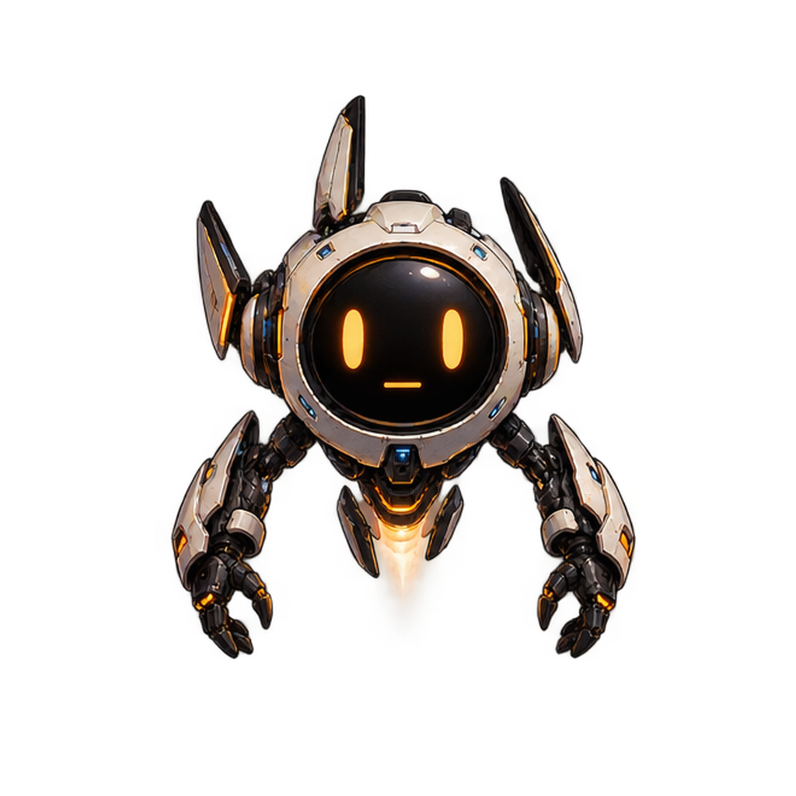
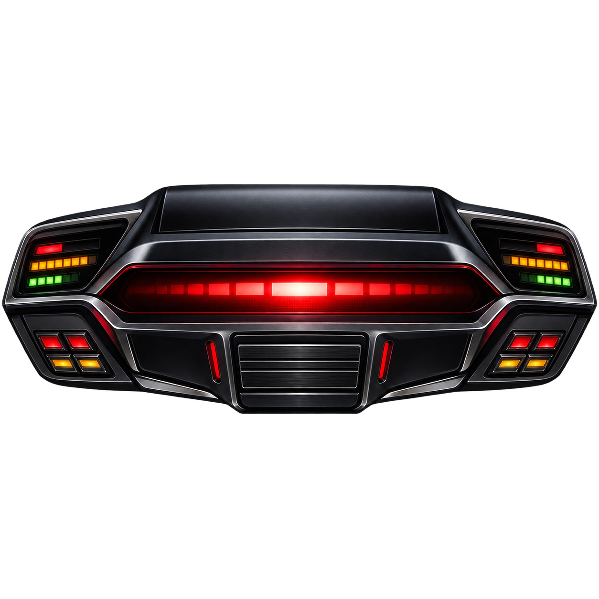
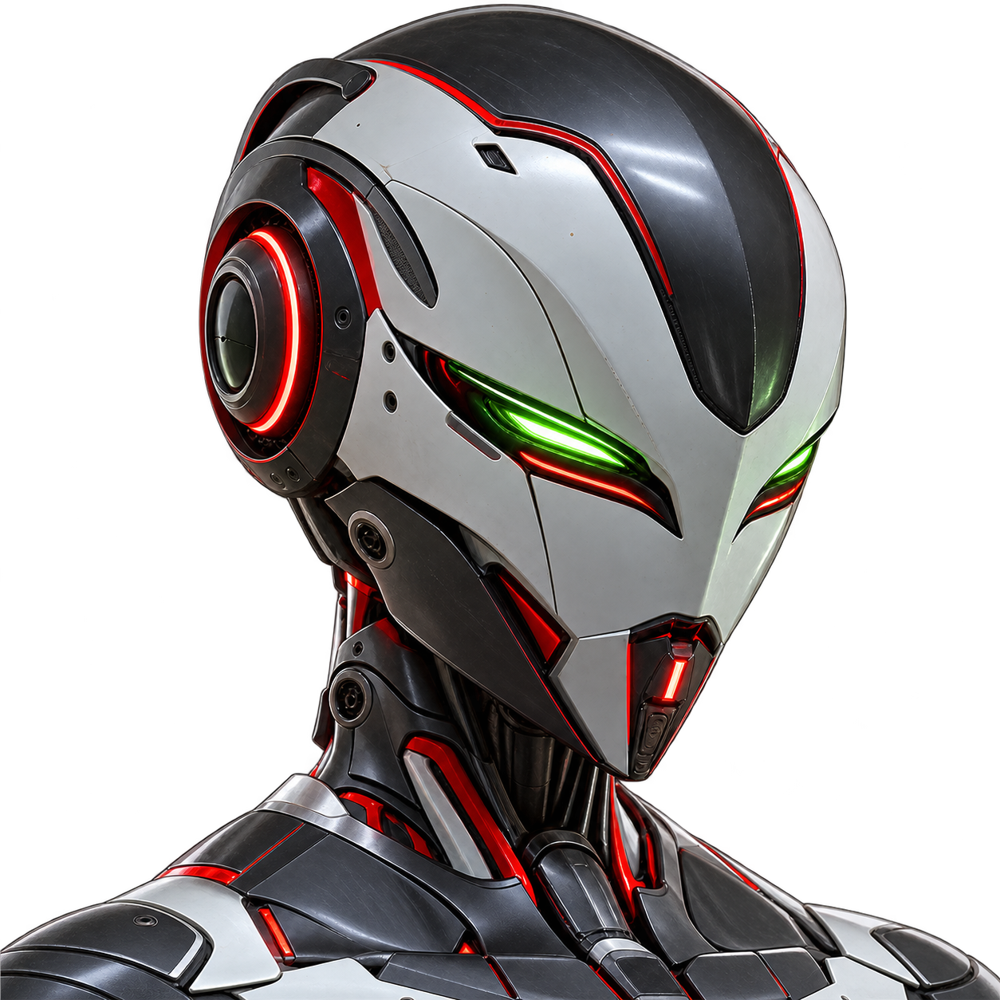

  

<h1 align="center">Sherka Companion</h1>

<strong>A voice. A personality. A place on your desktop.</strong>

Talk naturally. Interrupt freely. Give your AI a place on your desktop.

<em>Your models. Your voices. Your companion.</em>

  

  <a href="https://github.com/ArthurReboulSalze/Sherka-Compagnon/releases/latest"><strong>↓ Download for Windows &amp; Linux</strong></a> &nbsp;·&nbsp;
  <a href="https://arthurreboulsalze.github.io/Sherka-Compagnon/">Website</a> &nbsp;·&nbsp;
  <a href="docs/GETTING_STARTED.md">Quick start</a> &nbsp;·&nbsp;
  <a href="docs/README.md">Documentation</a> &nbsp;·&nbsp;
  <a href="docs/ROADMAP.md">What's next</a>

---

  

<em>Voice, conversation scenes and companion creation — connected to your own models.</em>

  

<em>Your companion on the desktop. Everything you need in the control panel.</em>

**Sherka 1.3 is here: create your own companion from an idea.** Shape its personality, approve its portrait, generate six emotions and give it a transparent place on your desktop. The new **Character creation** studio connects your LLM and ComfyUI in one guided flow. [What's new](docs/releases/1.3.0.md). **1.3.1** makes voice conversations snappier: shorter first spoken phrases, smoother interruptions and a local timing log. [Details](docs/releases/1.3.1.md).

## Meet your companions

Choose your company, then give each character its own voice and model. Five bundled companions, expressive avatars and all character settings together in **Companions**.

<table>
  <tr>
    <td align="center"> <strong>Sherka</strong> Calm, warm, attentive.</td>
    <td align="center"> <strong>Botsy</strong> Your curious little tinkerer.</td>
    <td align="center"> <strong>Alba</strong> <em>White &amp; gold android.</em> Playful, lively, adventurous.</td>
    <td align="center"> <strong>Kit</strong> Precision and deadpan wit.</td>
    <td align="center"> <strong>Minerva</strong> <em>Armored android.</em> Fiery, impatient, sharp-tongued.</td>
  </tr>
</table>

**😐 Neutral · 😊 Joy · 😢 Sadness · 😠 Anger · 😮 Surprise · 🤔 Reflection · 🥰 Tenderness**

Expressions follow the tone of a reply and blend with a gentle **half-second crossfade**. Use the bundled images or assign your own in **Avatar & voice**, alongside that character's VoiceStudio voice. Enable **Persistent moods** per companion to let repeated reactions linger, soften over later exchanges and respond to a change in tone. Reset mood independently of messages and memories. Short examples help small models choose an expression; a conservative fallback reads the visible reply when the marker is missing. [See how it works](docs/USER_GUIDE.md#how-expressions-change).

Hermes keeps a neutral avatar and its own personality, memory and tools. Its **/stop** button stops the current task while leaving the server running.

## A conversation that keeps up with you

Sherka gives your AI a presence beyond a chat window: a transparent companion that lives on your desktop, with a voice and a personality of its own. Run conversations locally, connect your favorite model API, or talk directly to your Hermes agent.

| 🎙️ Talk naturally | ✨ Make it personal | 🪟 Keep it close |
| --- | --- | --- |
| Interrupt a spoken reply — it fades out instead of cutting — pause while talking, then continue. Streaming and speech prepared ahead keep the exchange flowing. | A personality, image, voice and provider for every companion. Each keeps its own history. | An independent transparent avatar. Move it anywhere; controls appear on hover or click and follow your selected theme. Its active halo keeps the character's own color. |
| **🧠 Memories you control** | **🌐 A little help from the web** | **💬 Seven interface languages** |
| Persistent memory for each companion. Review, edit or delete facts; preview built-in memory optimization before applying it. Clear a conversation with confirmation while keeping saved facts. | [Search the web with sources](docs/WEB_SEARCH.md). Use DuckDuckGo without an account, or Brave, Tavily or SearXNG. Drop text files and, with a vision-capable model, images onto your companion. | French, English, Spanish, Italian, German, Simplified Chinese and Japanese. |

The built-in Sherka is ready in every interface language. Custom companions keep the language you choose for them.

## Bring your own companion to life

  
  

<em>Live on your desktop, with conversation illustrations beside your companion.</em>

Open **Companions → Create with AI**. Your connected LLM proposes an editable personality and appearance, then ComfyUI brings the character to life:

1. **Approve its portrait.** Generate a front-facing head-and-bust portrait with SDXL or Illustrious on a solid gray background.
2. **Give it six emotions.** Flux Klein 4B edits the approved portrait. Generate or retry each expression individually, and click any image to inspect it in a large preview.
3. **Make it transparent.** Apply automatic background removal to the seven portraits, review the cutouts, then add the companion and choose its VoiceStudio voice.

Choose the models; the three workflows use fixed settings focused on quality. Your model selections are remembered. A new companion starts with its own empty conversation and memory. The required ComfyUI nodes and models are separate installations; the in-app **Help & about** and [creation guide](docs/COMFYUI.md#character-creation) explain the setup.

## Turn conversations into scenes

Connect [ComfyUI](docs/COMFYUI.md), choose an **Illustrious or SDXL model**, describe the character's appearance and add your favorite LoRAs. Each companion keeps its model family, folders, editable negative prompt and LoRAs. A **positive prompt addition** appends your style, lighting or composition preferences to every generated scene, exactly as written. A separate **character negative prompt** excludes unwanted features only when the companion appears. Landscapes can stand alone; the avatar appears when it belongs in the scene. Images start preparing as soon as the reply text is ready, while the voice continues.

**Your request sets the scene.** Ask your robot companion to dance in a ballet outfit, and its usual armor or serious expression should not freeze the result into the same portrait. The planner prioritizes your requested action, clothes and setting, uses the reply for compatible details, and distinguishes one companion from a scene involving both of you. Prompt and character fidelity still depend on your chosen models and LoRAs.

The **Image** button reveals a movable, resizable cell that follows your companion. Generate up to eight variations and let them loop with gentle crossfades at your chosen pace. The **Text** button reveals a transparent input just beneath the controls: type, paste or drop text, and attach images when your model supports vision.

**Live scenes, with conversation first.** Enable live mode for continuous variations that follow the latest exchange. Sherka pauses its image work for speech recognition, text generation and speech synthesis, then resumes automatically. Choose portrait, landscape or square formats, latent scaling and an optional final ×2 upscale. Set each sampler’s steps and CFG independently. Open, edit, import or export the API workflow from the same settings.

**Ready when you are.** Model, LoRA and sampler lists are remembered on this device; the highlighted refresh button rescans the whole catalog. For a local Python or portable ComfyUI installation, save its folder and optional Python path in **Settings**: Sherka can start it when illustrations are enabled. The first images take longer while the server and models load. Remote servers remain manually managed.

Each companion can independently enable or disable its neutral portrait as an **IP-Adapter reference** for conversation illustrations. Keep it on for likeness, or off for more freedom from the reference image. See the [ComfyUI guide](docs/COMFYUI.md) for required nodes and models.

These scenes illustrate the conversation; the avatar's seven expressions remain separate. Hermes uses its own tools and stays outside local scene generation.

## Create, duplicate, share

Make a copy of a companion to try a new personality, model or voice with an empty history. Export it as a **.sherka.zip** pack: personality, instructions, settings and all seven expression images travel together. Importing creates an independent companion; conversations, memories and API keys stay private.

The [open archive format](docs/COMPANION_PACKS.md) uses ordinary ZIP, JSON and PNG files. Older Sherka JSON profiles still import. Model and voice references are included; their weights and audio files are separate downloads. Check connection settings on the receiving machine.

## Local voice. Your choice of intelligence.

**[VoiceStudio](https://github.com/debpalash/VoiceStudio) powers speech recognition, synthesis and voices.** Install it and your preferred speech models separately. Sherka can start its prepared Python server in the background, without opening the VoiceStudio window. Configure the connection, transcription model and local paths once in **Settings**; choose each companion's voice in **Avatar & voice**.

| How you want to talk | What you connect |
| --- | --- |
| **Keep conversations local** | [LM Studio](https://lmstudio.ai/) and downloaded models. Conversation can work offline. |
| **Choose a hosted model** | OpenRouter, Z.ai API or Coding Plan, OpenAI, Anthropic, or a compatible API. [Provider setup](docs/PROVIDERS.md). |
| **Talk to your Hermes agent** | Your Hermes server and profile. Hermes keeps its personality, memory and tools; Sherka handles the avatar and voice. [Hermes setup](docs/HERMES.md). |

With VoiceStudio on your PC, voice processing stays local. Hosted model APIs receive conversation context and may charge for usage; Hermes follows your server's configuration. API keys use Windows Credential Manager or Linux Secret Service and are excluded from exported profiles.

Sherka manages context budgets and offers reasoning controls where supported. Switching companions also handles local model loading and unloading.

## Shared services, personal layouts

Configure web-search providers and API keys, VoiceStudio transcription and local service startup once in Settings. VoiceStudio can run in the background without its desktop window; VoiceStudio and ComfyUI each have a **Start with Sherka** switch. Servers started by Sherka close with it; servers already running remain independent. **Help & about** provides a compact setup guide; a headset and a quiet environment give the best voice results.

Each companion remembers its desktop size, position and image-cell layout, even after restarting. Overlapping illustrations stay behind the avatar. **Double-click an illustration for full screen**, with the companion still movable and resizable in front; press Esc to return. Enable **Spontaneous conversation** per classic companion and choose a minimum and maximum idle delay: a short invitation breaks the silence, then your companion waits for a real reply. Typing, ongoing speech, voice pause and a hidden widget postpone it. Hermes keeps its own behavior. [Setup details](docs/GETTING_STARTED.md#spontaneous-conversation).

## Responsive without a huge setup

With suitable local language and speech models, Sherka can feel very responsive: text streams in, the voice starts after a short first phrase while the rest is prepared, and new image scenes start while the voice is still speaking. There is no fixed latency promise — model size, context, voice engine and concurrent image generation all matter. For the snappiest voice chat, pick a streaming speech-recognition engine and switch off model thinking; a [local timing log](docs/USER_GUIDE.md#measure-response-times) shows where each second goes.

Development and real-service testing used an **NVIDIA RTX 3090**. You do not need that much VRAM to start: **8 GB, and potentially less with small quantized models**, can suit a voice-companion setup. Running a large language model, speech and ComfyUI together needs more headroom; hosted conversation providers are also available.

## From download to your first conversation

1. **Pick your download:** the [Windows x64 installer, no-install ZIP or Debian x64 package](https://github.com/ArthurReboulSalze/Sherka-Compagnon/releases/latest).
2. **Connect voice and intelligence:** set up VoiceStudio in Settings, then choose LM Studio, an API provider or Hermes in Companions.
3. **Choose your companion and voice, turn on the microphone, and talk.** The avatar appears at startup; the control panel is there whenever you need it.

Follow the [getting-started guide](docs/GETTING_STARTED.md) for Windows or the [Linux guide](docs/LINUX.md) for Debian. Windows requires WebView2 and the Visual C++ x64 runtime. Models and voices are separate downloads. Headphones are recommended for voice interruption; the microphone is off at startup.

Check for signed Windows updates directly from **Settings**. Installed and no-install copies share your Windows user data. Linux uses its own user data folder and manual package updates; external services require their own installation. The Debian port has compilation and headless startup validation; physical audio and desktop behavior need broader testing.

## What's next

Next comes polish: faster responses, refined features and interface, and more local and cloud providers such as Ollama. Hermes remains outside the emotion and illustration systems.

There is plenty still to explore. Speed depends on your hardware and model choices, and speaker echo handling still needs broader testing. See the [roadmap](docs/ROADMAP.md) and [current status](docs/PROJECT_STATE.md).

## Open source, made to grow

Created by [Arthur Reboul Salze](https://github.com/ArthurReboulSalze). Sherka's code is **[GPLv3](LICENSE)**; dependencies retain their [own licenses](THIRD_PARTY_NOTICES.md).

The retrofuturistic artwork is an original, freely inspired creation. No Ulysses 31 artwork is distributed, and the project is unaffiliated with the series.

Have an idea? [Open an issue](https://github.com/ArthurReboulSalze/Sherka-Compagnon/issues), explore the [documentation](docs/README.md), or [build and contribute](docs/DEVELOPMENT.md).
